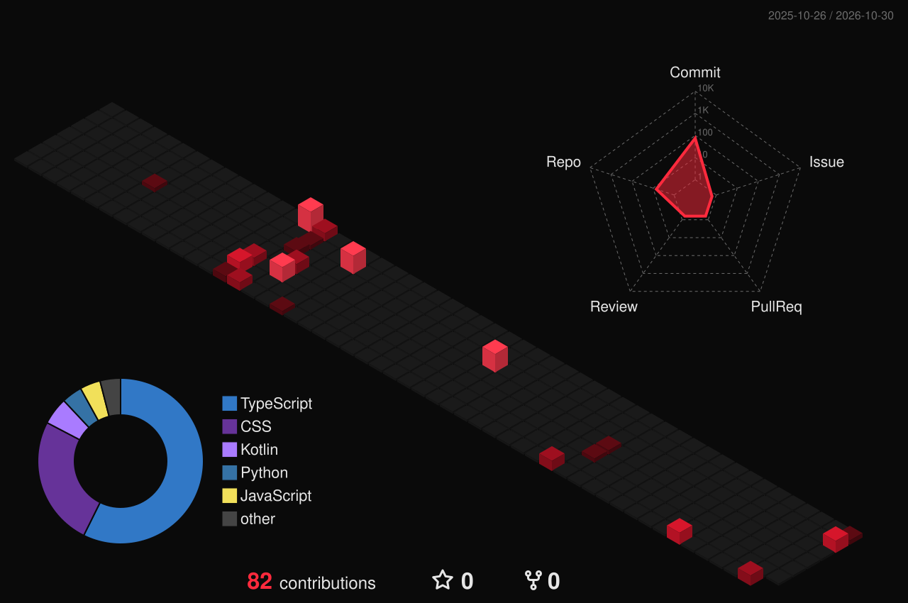

<p align="center">
  
</p>

<p align="center">
  <a href="https://git.io/typing-svg"></a>
</p>

<p align="center">
  <a href="https://tejastholar-portfolio.vercel.app"></a>
  <a href="https://www.linkedin.com/in/tejas-tholar-36b016317"></a>
  <a href="mailto:tejastholar@outlook.com"></a>
</p>

## `> whoami`

```js
const tejas = {
  city:   "Mumbai, IN",
  study:  "BCA, Somaiya '27",
  intern: "NetSec, Indian Oil",
  builds: "full-stack web apps",
  learns: "VAPT · AppSec",
  motto:  "Break it. Defend it."
};
```

## `> git log --3d`

<p align="center">
  
</p>

## `> ./arsenal`

**Build**

<p align="left">
  
  <br/>
  
</p>

**Break & defend**

<p align="left">
  
  <br/>
  
  
  
  
</p>

## `> ls ~/projects`

### 🍽️ [DineFlow](https://dineflow-zeta.vercel.app)
Restaurant QR-ordering system: scan the table's QR, browse the menu, order and pay online.
`Next.js` `Supabase` `Razorpay` · **[Live →](https://dineflow-zeta.vercel.app)**

### 🌐 [BREACH → DEFEND Portfolio](https://tejastholar-portfolio.vercel.app)
My portfolio as an attack-then-defend story, with a 3D globe threat map.
`React` `three.js` `TypeScript` · **[Live →](https://tejastholar-portfolio.vercel.app)** · **[Code →](https://github.com/Tejas-Tholar/MY-Portfolio)**

### 🤝 [BrandlyCollab](https://brandlycollab.in)
A marketplace connecting creators with brands, which I run.
**[Visit →](https://brandlycollab.in)**

## `> cat stats.log`

<p align="center">
  
  
</p>

<p align="center">
  
  <br/>
  
</p>
